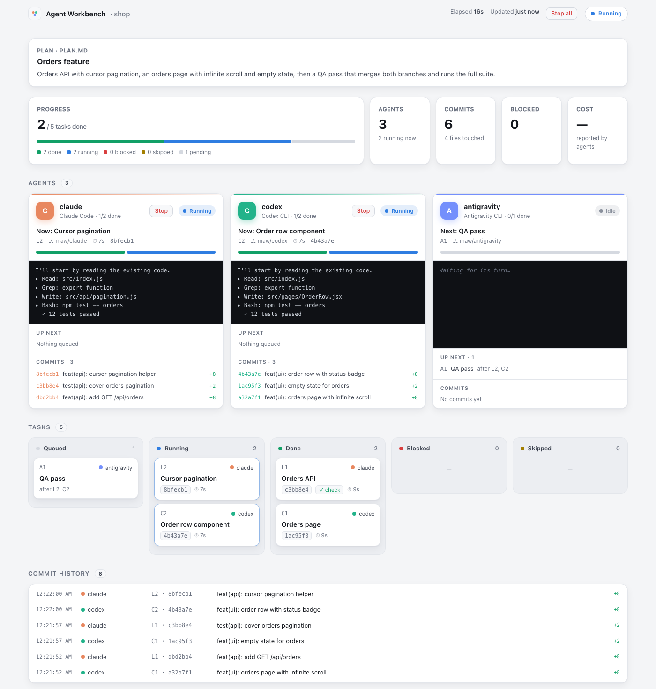

# Multi-Agent Workbench

[](https://www.npmjs.com/package/multi-agent-workbench) [](https://github.com/ruhul0/multi-agent-workbench/actions/workflows/ci.yml) [](LICENSE)

Write a plan, let `maw` split it into micro-tasks, and run them in parallel across Claude Code, Codex, Antigravity or any other agent CLI. Each agent works in its own git worktree. Failed checks go back to the agent for another try, and a live dashboard shows what every agent is doing, what it will do next, and every commit with its diff. When the run ends, `maw review` and `maw merge` bring the finished work together.

<picture>
  <source media="(prefers-color-scheme: dark)" srcset="https://raw.githubusercontent.com/ruhul0/multi-agent-workbench/main/docs/dashboard-dark.png">
  
</picture>

> **Warning:** `maw` starts agents with their permission prompts disabled (`--dangerously-skip-permissions`, `--dangerously-bypass-approvals-and-sandbox`). They can run any command as your user. Only use it on repositories and machines where that is acceptable, and review every commit before merging.

## Requirements

- Node.js 20 or newer, on macOS or Linux (Windows is not supported yet)
- A git repository with at least one commit
- At least one agent CLI, logged in: [`claude`](https://docs.claude.com/en/docs/claude-code), [`codex`](https://github.com/openai/codex), `agy` (Antigravity), or any CLI you [define yourself](#custom-agents)

## Quick start

```bash
npm install -g multi-agent-workbench
cd your-project
$EDITOR PLAN.md          # 1. write the plan: goal, parts, constraints, how to verify
maw plan PLAN.md         # 2. split it into micro-tasks and assign agents (writes tasks.json)
maw doctor               #    are those agents installed and logged in?
maw run --dry-run        #    check the task list
maw                      # 3. run it; the live dashboard opens in your browser
maw review               # 4. commits, changes and check results per task
maw merge --check "npm test"   # 5. merge finished work into maw/integration and test it
git merge --ff-only maw/integration
maw clean --branches     # remove maw's worktrees and merged branches
```

Without installing: `npx multi-agent-workbench <command>`. Prefer to write tasks by hand? `maw init` creates a starter `tasks.json`.

## How it works

1. **Plan.** You describe the work in `PLAN.md` (see [`examples/PLAN.md`](examples/PLAN.md)).
2. **Micro-tasks.** `maw plan` asks a planner agent (Claude by default, read-only) to read the plan and the repo and return small tasks, each with an owner, a self-contained prompt, an optional `check` command and dependencies. The result is validated before it is written.
3. **Assign and run.** Each owner gets a queue, a worktree at `../<repo>-<owner>` and a branch `maw/<owner>`. Queues run in parallel; tasks in one queue run in order. Isolated tasks (`"isolate": true`) get their own worktree and run alongside.
4. **Retry with feedback.** If the agent fails or its `check` fails, the error output is sent back to the same agent session (Claude Code and Codex resume their session) for up to `retries` more attempts.
5. **Watch.** The dashboard shows the plan, every agent's live output, current task and what's next, all commits with diffs, changed files, costs and an activity log. You can stop or skip tasks from it.
6. **Review and merge.** `maw review` summarizes each task's work. `maw merge` merges finished work into an integration worktree, stopping at the first conflict, and runs your tests on the result. A partly failed queue only merges the commits of tasks that finished.

## tasks.json

```json
{
  "$schema": "https://unpkg.com/multi-agent-workbench/tasks.schema.json",
  "plan": { "title": "Orders feature", "summary": "Orders API, then the page, then QA." },
  "max_parallel": 3,
  "budget_usd": 15,
  "tasks": [
    { "id": "L1", "owner": "claude", "task": "Orders API", "prompt": "Add GET /api/orders with pagination. Run the API tests and commit.", "check": "npm test -- orders", "retries": 1 },
    { "id": "C1", "owner": "codex", "task": "Orders page", "prompt": "Build the orders page. Run lint and commit.", "check": "npm run lint", "retries": 1 },
    { "id": "A1", "owner": "antigravity", "command": "agy", "task": "QA", "depends_on": ["L1", "C1"], "prompt": "Merge maw/claude and maw/codex into this branch, run all tests, fix only clear bugs, and commit." }
  ]
}
```

- `depends_on` waits for other tasks; if one fails, its dependents are skipped. If a task is blocked, the rest of that owner's queue is skipped.
- `check` is a shell command run after the agent finishes; with `retries`, its failure output goes back to the agent.
- `model`, `effort`, `timeout_minutes`, `check_timeout_minutes` and `max_cost_usd` can be set per task (or with `CLAUDE_MODEL`, `CODEX_MODEL`, `AGY_MODEL` and the matching `*_EFFORT` env vars).
- A plain array of tasks also works.
- Mistakes such as unknown agents, duplicate ids, two worktrees on one branch, or dependency cycles (counting queue order) are caught before anything runs.

The `$schema` line gives editors autocomplete and validation. Full field reference: [`skills/multi-agent-workbench/references/task-schema.md`](skills/multi-agent-workbench/references/task-schema.md). More examples: [`examples/`](examples).

## Commands

| Command | What it does |
|---|---|
| `maw plan [PLAN.md \| "goal"]` | Split a plan into micro-tasks and write `tasks.json`. `--agents claude,codex` limits who gets work, `--planner <agent>` picks the planner, `--force` replaces an existing file. |
| `maw init [--force]` | Create a starter `tasks.json` by hand. |
| `maw doctor [--json]` | Check the agents used in `tasks.json` are installed and logged in. Exits 1 if any are not. Never prints account details. |
| `maw` / `maw run` | Run the queues and open the live dashboard. Exits 0 only if every task is done. `--dry-run` validates and prints the plan; `--resume` keeps tasks already done in the last run; `--max-parallel N`; `--notify` for a desktop notification; `--no-open`; `--no-dashboard`. |
| `maw status` | Summarize the last run. |
| `maw review [--json]` | Each task's commits, line counts, check result and leftover changes. |
| `maw merge` | Merge finished work into a `maw/integration` worktree. `--check "<cmd>"` tests the result, `--only L1,C1` picks tasks, `--into-current` merges into your checked-out branch instead. |
| `maw clean` | Remove maw's worktrees. `--branches` also deletes merged branches, `--force` discards changes and unmerged branches. |
| `maw dashboard [--port N]` | Serve the dashboard on its own, e.g. to look at a finished run. |
| `maw install-skill` | Install the coordinator skill for Codex and Claude Code (`--codex` / `--claude` for one). |

All commands accept `--tasks <file>`. Unknown flags are rejected, so a typo never starts a run by accident.

## Live dashboard

`maw` serves the dashboard at http://127.0.0.1:4317 (or the next free port) and opens it in your browser. It shows:

- the plan, overall progress, commits, files touched and cost
- each agent's current task (and attempt), live output, **up next** queue and its commits
- a task board by state; open a task for its prompt, commits, changed files and a full diff
- a commit history across all agents — click any commit to see its diff
- an activity log of starts, retries, failures and merges
- **Stop** / **Skip** buttons per task and **Stop all** while a run is going

It only answers requests addressed to localhost, and its buttons need a token embedded in the page, so other websites can neither read it nor press them. When the run finishes, the page stays up until you press Ctrl+C. In scripts and CI (no terminal attached) `maw` exits as soon as the run ends, and the browser is not opened when `CI` is set.

## Costs, limits and safety

- **Cost.** Claude Code and Codex report usage; the dashboard and `maw status` show it. `budget_usd` stops new tasks once the run has spent that much; `max_cost_usd` caps a single task (enforced by Claude Code itself).
- **Environment.** By default agents inherit your environment. `"env": { "allow": ["ANTHROPIC_API_KEY"], "set": { "CI": "1" } }` passes only basic variables (PATH, HOME, …) plus the ones you list.
- **Sandbox.** `"sandbox": ["docker", "run", "--rm", "-v", "{worktree}:{worktree}", "-w", "{worktree}", "my-agent-image"]` wraps every agent and check in that command.
- **Timeouts.** `timeout_minutes` (default 60) and Ctrl+C stop the agent and everything it started. Press Ctrl+C twice to force-quit.
- **One run at a time** per repository; a second `maw` refuses to start.
- **Notifications.** `"notify": { "desktop": true, "webhook": "https://hooks.slack.com/..." }`.

## Custom agents

Any CLI that takes a prompt can be an agent:

```json
"agents": {
  "gemini": {
    "label": "Gemini CLI",
    "bin": "gemini",
    "args": ["--yolo", ["--model", "{model}"], "-p", "{prompt}"],
    "plan_args": ["-p", "{prompt}"],
    "auth": null
  }
}
```

Then use `"owner": "gemini"`. A nested array is an optional group that is dropped when a placeholder in it is empty. Placeholders: `{prompt}`, `{model}`, `{effort}`, `{id}`, `{worktree}`. Override the binary at run time with `MAW_BIN_GEMINI`. Custom agents are retried with the error appended to the original prompt, since maw cannot resume their sessions.

## Output

- `.agent-workbench/status.json`: the plan, every task's state, attempts, commits (with time and line counts, read from git), changed files, uncommitted changes, check result, cost and last 40 lines of output
- `.agent-workbench/logs/<id>.log`: full output per task
- `.agent-workbench/supervisor.log`: event log

`maw` adds `.agent-workbench/` to `.git/info/exclude`, so it never shows up in `git status`.

## Use as a skill or plugin

The skill tells a coordinating agent how to take your plan, run `maw plan`, get your approval, run `maw`, keep you posted, and review and merge the results.

Claude Code plugin:

```text
/plugin marketplace add ruhul0/multi-agent-workbench
/plugin install multi-agent-workbench@multi-agent-workbench
```

Or copy the skill for Codex and Claude Code:

```bash
maw install-skill
```

Then ask:

- Codex: `Use $multi-agent-workbench to run PLAN.md: frontend to Codex, backend to Claude, QA to Antigravity.`
- Claude Code: `/multi-agent-workbench run PLAN.md across Claude, Codex and Antigravity`

## Development

```bash
npm test        # end-to-end tests with fake agent CLIs
npm run check   # syntax check
```

See [CHANGELOG.md](CHANGELOG.md) for release notes.

## License

MIT
